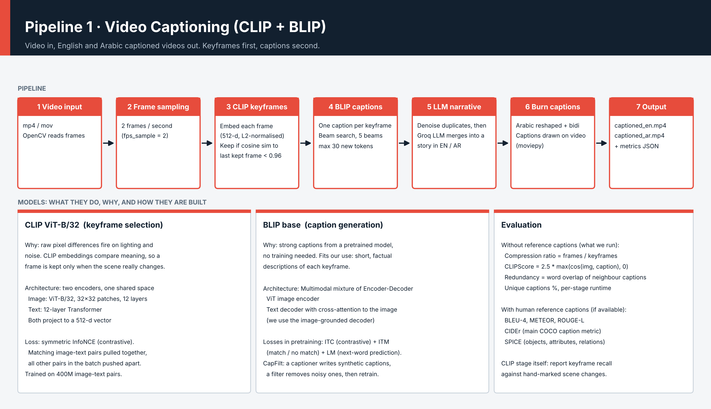
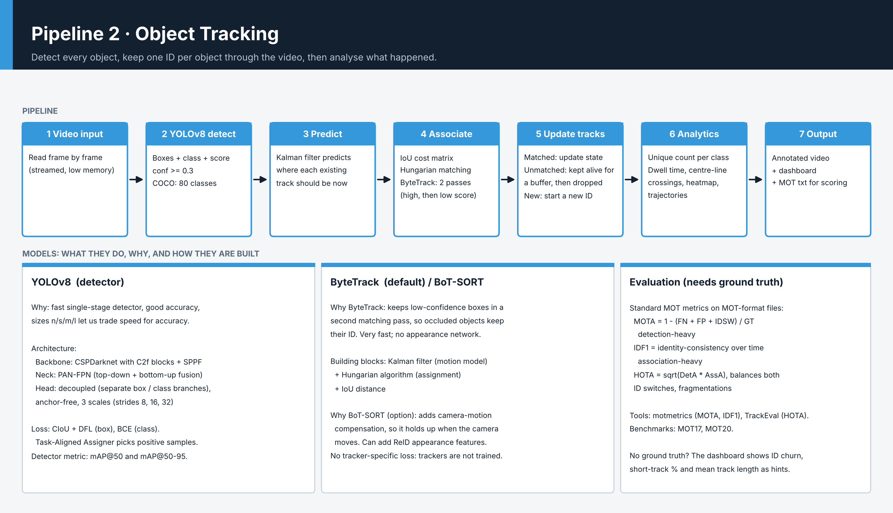
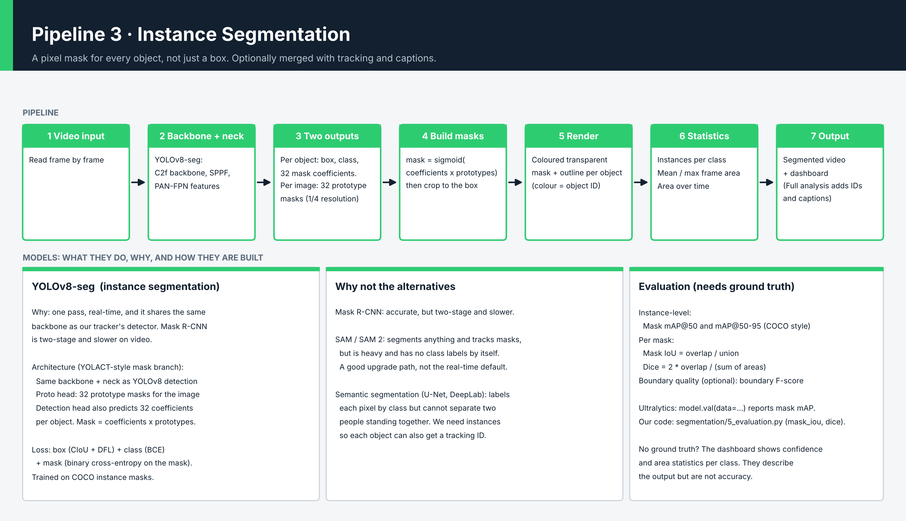

# Video Intelligence

Upload a video and get back four kinds of understanding, all from one small web app:

- **Captioning** - what is happening, written as a story, spoken aloud, with the subtitle words lighting up as they are said (English and Egyptian-Arabic voice).
- **Tracking** - every object gets a stable ID, with trails, counts, dwell time, line crossing and a heatmap.
- **Segmentation** - pixel-accurate masks for every object, with per-class area statistics.
- **Full analysis** - all of the above on one video, with one dashboard.

Built on CLIP + BLIP (captioning), YOLOv8 (detection and segmentation), ByteTrack / BoT-SORT (tracking), a Groq LLM (narrative) and edge-tts (voice).

<p align="center">
 


</p>

> **Screenshots:** the images in this README live in `docs/screenshots/`. Replace each placeholder with your own screenshot, keeping the same file name (details at the end).

---

## Demo

| **Captioning** | **Tracking** |
|---|---|
| | |
| **Segmentation** | **Full analysis** |
| | |

### Analytics dashboard


### Word-by-word subtitles


---

## What each page does

### 1. Captioning
```
video -> frames (2 fps) -> CLIP keyframes -> BLIP captions -> LLM narrative
      -> voice-over (word timestamps) -> subtitles burned word by word -> .mp4
```
1. **Frame extraction** samples frames at a chosen rate.
2. **CLIP keyframe selection** keeps a frame only if its CLIP embedding is less similar than a threshold (default 0.96) to the last kept frame, so near-duplicates are dropped.
3. **BLIP** writes a caption for each keyframe (beam search 5, repetition penalty 1.2).
4. **Groq LLM** merges the keyframe captions into one connected narrative, in English or Arabic.
5. **edge-tts** speaks the narrative and returns a timestamp for every word. If it is unavailable the app falls back to gTTS and estimates the word times from the word lengths and the audio duration.
6. The video is re-rendered with the narrative as subtitles: the word being spoken is highlighted, spoken words are white, upcoming words are dimmed. If the voice is longer than the video, the last frame is held so speech is not cut.

### 2. Tracking
```
video -> YOLOv8 detection -> ByteTrack / BoT-SORT -> analytics -> rendered video + dashboard
```
- **Detection** gives boxes, classes and confidences for each frame, with no memory between frames.
- **Tracking** links detections across frames so each object keeps one ID. This is what lets you count *distinct* objects rather than boxes per frame.
- **Analytics:** dwell time per object, line-crossing counts, a movement heatmap and per-class counts.

### 3. Segmentation
YOLOv8-seg predicts a mask for every object. The page shows the masks and statistics such as the area each class covers.

### 4. Full analysis
Runs segmentation, tracking and captioning on the same video and combines the results in one dashboard.

---

## Models and why they were chosen

| Task | Model | Why this one |
|---|---|---|
| Keyframe selection | **CLIP ViT-B/32** | Embeds images in a space where similar-looking frames are close, so a cosine threshold removes near-duplicates cheaply. |
| Captioning | **BLIP (base)** | Trained for both understanding and generation, with caption bootstrapping (CapFilt) that cleans noisy web captions. Good quality for its size. |
| Narrative | **Groq LLM** | Turns a list of short, repetitive captions into a fluent story and translates it to Arabic. |
| Voice | **edge-tts** (gTTS fallback) | Neural voices (including Egyptian Arabic) and per-word timestamps for synchronised subtitles. |
| Detection | **YOLOv8** | Single pass, real-time, anchor-free decoupled head. Backbone with C2f blocks and SPPF, PAN-FPN neck for small and large objects. |
| Segmentation | **YOLOv8-seg** | Same detector plus 32 mask prototypes and per-object coefficients, so masks come almost for free. |
| Tracking | **ByteTrack** (default) / **BoT-SORT** | See below. They are algorithms that run on top of the detector, not extra neural networks to download. |

### ByteTrack vs BoT-SORT
- **ByteTrack:** associates high-confidence boxes first, then uses low-confidence boxes to rescue tracks that are partly hidden, so IDs survive occlusion. No appearance network, so it is fast. Best for a fixed camera or small motion.
- **BoT-SORT:** a similar idea with camera-motion compensation (and optional appearance). More robust when the camera moves, a bit slower.
- Both use a Kalman filter to predict where each object will be, and the Hungarian algorithm to match predictions to detections.

> In YOLOv8 there is no separate *objectness* score (that was YOLOv5). The confidence of a box is the predicted class probability itself.

---

## Installation

**Requirements:** Python 3.12+, [uv](https://github.com/astral-sh/uv), an internet connection (model downloads, Groq, edge-tts). FFmpeg is bundled through `imageio-ffmpeg` (if you prefer, install it system-wide and add it to PATH).

```bash
git clone https://github.com/MaryamSayedGitHub/create-Video_Caption.git
cd create-Video_Caption
uv sync
uv pip install edge-tts
```

Create a `.env` file in the project root:

```
GROQ_API_KEY=your_key_here
```

### NVIDIA GPU (recommended)
`uv sync` installs a **CPU-only** PyTorch on Windows. To use an NVIDIA card (RTX 50-series needs CUDA 12.8 builds):

```bash
uv pip install --reinstall torch torchvision --index-url https://download.pytorch.org/whl/cu128
uv run --no-sync python -c "import torch; print(torch.__version__, torch.cuda.is_available())"
```
It should print a `+cu128` version and `True`. Use `--no-sync` when running so uv does not put the CPU build back. YOLO uses the GPU automatically; the original CLIP and BLIP scripts run on the CPU unless you add `.to("cuda")` to them.

## Run

```bash
uv run --no-sync python webapp/app.py
```
Open http://127.0.0.1:5000. The first run downloads the YOLOv8 weights (`yolov8n.pt`, `yolov8n-seg.pt`) and the CLIP and BLIP models.

You can also run the original command-line pipeline:

```bash
uv run python Final_Video_with_voice_over.py <video.mp4> [output.mp4]
```

## Options on the pages

| Option | Meaning |
|---|---|
| Frames sampled per second | How many frames per second CLIP examines. Higher is slower. |
| CLIP similarity threshold | Higher keeps more keyframes (0.96 default). |
| Tracker | ByteTrack (default) or BoT-SORT. |
| Model size / image size / confidence | Trade accuracy against speed. Start with the smallest model (`n`). |
| Languages | English and/or Arabic (Arabic needs the Groq key). |

---

## Project structure

```
create-Video_Caption/
├── 1_Frame_Extraction.py ... 6_burn_captions.py    original captioning pipeline (unchanged)
├── Final_Video_with_voice_over.py                  original command-line entry point
├── pyproject.toml, requirements.txt
├── webapp/
│   ├── app.py                  routes only
│   ├── jobs.py                 background job runner with progress
│   ├── common/                 loader, video_io (ffmpeg), voice (TTS + word times), subtitles, caption_bar
│   ├── features/
│   │   ├── captioning/         pipeline.py, 5_evaluation.py
│   │   ├── tracking/           1_detection, 2_tracking, 3_analytics, 4_render, 5_evaluation, pipeline
│   │   ├── segmentation/       1_segmentation_model, 2_masks, 3_render, 4_statistics, 5_evaluation, pipeline
│   │   └── full_analysis/      pipeline.py
│   ├── templates/, static/     the four pages
└── docs/
    ├── pipeline_1_captioning.png, pipeline_2_tracking.png, pipeline_3_segmentation.png
    ├── Interview_Notes_Video_Intelligence.pdf
    ├── screenshots/            images used in this README
    └── study/, gen/            study notes and figures
```

## Pipeline diagrams




## Evaluation

| Area | Metrics in the project |
|---|---|
| Captioning | CLIPScore per keyframe (reference-free); BLEU, ROUGE-L, CIDEr, METEOR, SPICE when reference captions exist |
| Tracking | Without ground truth: ID churn, short-track percentage, track length. With ground truth: MOTA, IDF1, HOTA, ID switches |
| Detection / segmentation | mAP (box and mask), computed on a labelled set |

The tracking proxies are indicators only, not accuracy: without labelled ground truth, no tracker can be given a real MOTA.

## Troubleshooting

| Symptom | Cause and fix |
|---|---|
| `Expected a Python module at: src\video_caption\__init__.py` | Old pyproject. Use the current one (`[tool.uv] package = false`). |
| `ValueError: At least one stride in the given numpy array is negative` (CLIP) | Fixed by converting frames to PIL RGB before the processor. Restart the server so the new file is loaded. |
| `Error passing ffmpeg -i command output` (moviepy) | Video has a timecode data stream. The captioning page no longer uses moviepy. |
| GPU not used (`+cpu`) | See the NVIDIA section above. |
| Voice missing, notes say gTTS | edge-tts is not installed or has no internet. `uv pip install edge-tts`. |
| Arabic text shows as separate letters | Install `arabic-reshaper` and `python-bidi` (already in pyproject). |
| Labels too small on 4K videos | Label size scales with video height; increase the scale in `4_render.py`. |

## Limitations
- Captions describe the scene in general terms; BLIP can repeat or miss small details.
- Word timing is exact only with edge-tts; with the gTTS fallback it is estimated.
- Tracking quality depends on the detector and on occlusion. IDs can still switch when objects cross for long periods.
- The first run needs internet for model downloads.

## Study notes
- `docs/Interview_Notes_Video_Intelligence.pdf` - interview preparation for this project.
- `Study_Notes_Models_Losses_Metrics.pdf` - every model, loss and metric used, with hand calculations.
- `Study_Notes_UNet_VAE_GAN_StableDiffusion.pdf` - generative models and U-Net family.

---

## Adding your screenshots

1. Run the app and take a screenshot of each page (Windows: `Win + Shift + S`).
2. Save each one **with the same name** inside `docs/screenshots/`, replacing the placeholder:

| File | What to capture |
|---|---|
| `01_home.png` | The home page |
| `02_captioning.png` | Captioning page after a run |
| `03_tracking.png` | Tracking result with boxes and IDs |
| `04_segmentation.png` | Segmentation result |
| `05_full_analysis.png` | Full analysis result |
| `06_dashboard.png` | The charts and heatmap |
| `07_subtitles_closeup.png` | One video frame with the highlighted word |

To add more images, put them in the same folder and add a line like ``. For a short demo clip, a GIF works well: ``.

## Author
Maryam Sayed - Electronics and Communication Engineering, Al-Azhar University.
